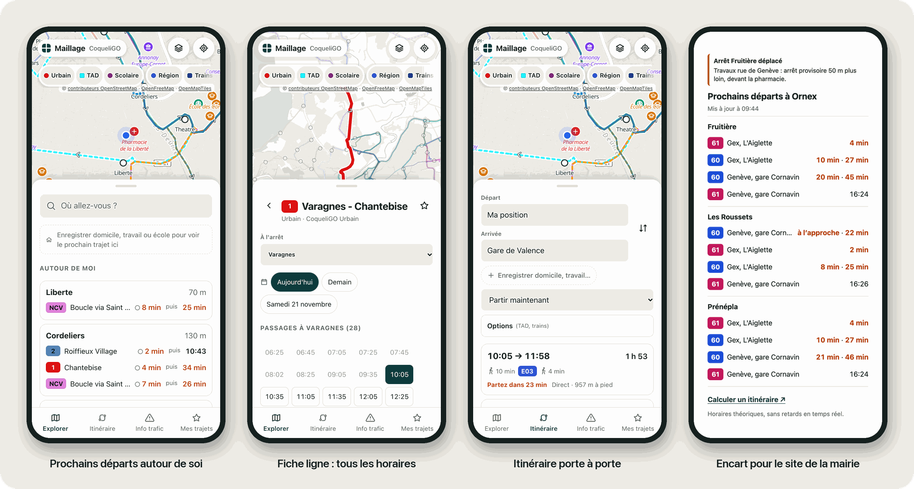

<div align="center">


# Maillage

**L'information voyageur des petites villes et des territoires ruraux,<br>construite à partir des données ouvertes.**

[](LICENSE)
[](LICENCE-DONNEES.md)
[](https://transport.data.gouv.fr)
[](https://preactjs.com)
[](https://maplibre.org)
[](pipeline/)

[Fonctions](#fonctions) · [Démarrer](#démarrer) · [Comment ça marche](#comment-ça-marche) · [Contribuer](#contribuer) · [Licence](#licence)



</div>

---

Les grands réseaux métropolitains (TPG, TCL, RATP…) ont de bonnes applications. Autour d'eux, l'information reste
morcelée : cars régionaux, transport à la demande, lignes locales, lieux de la commune, travaux annoncés par la mairie.
**Maillage** réunit tous les réseaux d'un territoire, à partir des horaires publiés en open data (GTFS), dans un service
web mobile que la commune intègre à son site et où elle publie ses propres messages. Il complète l'application du grand
réseau, sans la remplacer : temps réel, billets et réservation restent chez lui.

Le principe : **rendre les services compatibles entre eux**. Arrêts rapprochés d'un réseau à l'autre, itinéraires qui
enchaînent bus, cars et trains, formats ouverts et standards (GTFS, GTFS-RT, et demain GTFS-Flex et GBFS) pour brancher
un nouveau service sans développement.

Il s'adresse :
- **aux communes en bordure d'un grand réseau**, par exemple autour de Genève, de Lyon ou de Paris ;
- **aux petits réseaux** qui n'ont pas encore d'application complète, dont les voyageurs n'ont souvent que des fiches PDF.

- 📱 **Rien à installer** : une page web pensée pour le téléphone, sans compte, sans cookie, sans traceur.
- 🏘️ **Pensé pour les territoires** : bus urbains, cars régionaux, lignes scolaires, transport à la demande et trains
  réunis sur une même carte.
- 🏛️ **Au service des communes** : un encart à coller sur le site de la mairie et un espace pour publier des messages.
- 🔓 **Ouvert** : code libre, données ouvertes, standards (GTFS, OpenStreetMap).

Le dépôt contient les données de deux territoires de démonstration, construites à partir de leurs données ouvertes
(sources dans [LICENCE-DONNEES.md](LICENCE-DONNEES.md)).
Service en ligne : [maillage.tuatam.fr](https://maillage.tuatam.fr) (sur invitation pendant la phase pilote ; les encarts et l'espace mairie sont publics).

> [!NOTE]
> Projet indépendant, non affilié aux réseaux de transport dont il reprend les données.
> Les horaires sont **théoriques**, tels que publiés par les réseaux.

## Fonctions

### 🚌 Pour les voyageurs

- 🚏 **Prochains départs** autour de soi, par arrêt et par ligne, sur 48 h.
- 🧭 **Itinéraires** d'adresse à adresse, calculés dans le navigateur : marche par les rues, correspondances, TER et
  trains suisses, transport à la demande et lignes scolaires activables, tarif indicatif.
- 📋 **Fiches de ligne** qui remplacent les fiches PDF : schéma de la ligne (tronc commun, variantes), tous les départs
  du jour choisi, parcours détaillé.
- 🗺️ **Carte** : tracés recalés sur la chaussée et les voies ferrées, sens de circulation, gares, lieux utiles
  OpenStreetMap, fonds plan, vue aérienne et vélo.
- 🚆 **Gares** : départs et arrivées des trains en correspondance, avec le temps réel SNCF.
- ⏱️ **Temps réel des bus** quand le réseau le publie (GTFS-RT) : retards et suppressions aux arrêts, par un relais
  du serveur qui ne garde que les courses du territoire.
- ⭐ **Mes lieux** : domicile, travail, école et favoris enregistrés sur l'appareil, avec le prochain trajet vers chacun.
- ⚠️ **Info trafic** : messages publiés par les communes, alertes d'expiration des données.

### 🏛️ Pour les communes

- 🧩 **Encarts** (`widget.html`) à coller sur le site de la mairie : formats complet, compact et « Comment venir » à un
  lieu, aux couleurs de la commune, hauteur ajustée automatiquement. Démonstration : `demo-encarts.html`.
- ✉️ **Espace mairie** (`mairie.html`) : connexion par lien envoyé par e-mail, messages aux voyageurs, lieux utiles
  ajoutés ou masqués, statistiques de l'encart, générateur du code d'intégration.

## Démarrer

Prérequis : Node.js, Python 3 et, pour des tracés précis, Docker.

```bash
npm install
npm run dev
```

Puis ouvrir http://localhost:5199 (de préférence en vue mobile) : la page d'accueil propose les territoires. Accès direct : `?reseau=<territoire>`, l'identifiant d'un fichier de `pipeline/tenants/`.

Le dépôt contient une copie des données pour démarrer tout de suite. Pour les régénérer à partir des sources :

```bash
pipeline/osrm/osrm.sh start && pipeline/osrm/osrm.sh start-rail && pipeline/osrm/osrm.sh start-genf
npm run data
```

Les moteurs OSRM (Docker) recalent les tracés sur la chaussée et les voies ferrées ; à préparer une fois avec `prepare`, `prepare-rail` et `prepare-genf` (voir [EXPLOITATION.md](EXPLOITATION.md)). Sans eux, `npm run data` fonctionne, mais les tracés restent grossiers.

<details>
<summary>Téléchargements, trains suisses, éditeur de tracés et autres commandes</summary>

`npm run data` télécharge (avec repli automatique sur `curl` si le Python de python.org n'a pas ses certificats racine) les GTFS déclarés dans chaque `pipeline/tenants/<territoire>.json` (un seul territoire : `npm run data:<territoire>`), dont l'agrégat régional Oùra (~110 Mo). Comptez quelques minutes la première fois. Les données générées couvrent **60 jours** à partir du jour d'exécution : il faut relancer la commande ensuite.

**Trains suisses (territoires frontaliers de Genève).** Le flux `train-ch` part de l'horaire national suisse (opentransportdata.swiss, ~400 Mo pour deux années d'horaires, dont 3,7 Go de `stop_times` décompressés). `pipeline/extract_gtfs.py` n'en garde, en une minute, que les trains qui passent à moins de 13 km de Genève (≈ 4 Mo). Le Léman Express, les TER et les trains SNCF sont écartés : ils figurent déjà dans le flux SNCF. Les sources sont retéléchargées au plus tous les 3 jours. Chaque année, avant le changement de service de décembre, il faut ajouter l'horaire de l'année suivante (`timetable-AAAA-gtfs2020`) dans le fichier du territoire (`pipeline/tenants/<territoire>.json`) ; l'alerte d'expiration (`npm run check:data`) le rappelle 21 jours avant. Les lignes suisses sont tracées de gare en gare (le moteur ferroviaire OSRM ne couvre que Rhône-Alpes).

Éditeur de tracés (poste local, avec `npm run dev`) : http://localhost:5199/editeur.html, voir [EXPLOITATION.md](EXPLOITATION.md).

Autres commandes : `npm run test:router` (tests du calculateur sur les vraies données), `npm run check:data` (alerte d'expiration des données), `npm run build` (version statique dans `dist/`, pages `index.html` et `widget.html`) et `./deploy/deploy-vps.sh` (publication sur le serveur, voir [deploy/README.md](deploy/README.md)).

</details>

## Comment ça marche

```
pipeline/tenants/<id>.json       configuration d'un territoire (flux, liens, règles TAD, lacunes)
pipeline/build_network.py        Python standard : téléchargement, contrôle, corrections, réconciliation des arrêts
public/data/tenants.json         registre des territoires (page d'accueil)
public/data/<id>/network.json    réseau complet : lignes, arrêts, pôles, courses, calendriers (1 à 2 Mo, bien moins une fois compressé)
public/data/<id>/lines.geojson   tracés des lignes (2 à 3 Mo)
src/net.ts                       modèle, calendriers, prochains départs
src/router.ts                    calcul d'itinéraires (Connection Scan Algorithm)
src/map.tsx                      MapLibre GL 5 + fond OpenFreeMap
src/views/*                      écrans (Preact)
src/widget.ts                    encarts pour les sites de communes
mairie/serveur.py                espace mairie (connexion, messages, lieux, statistiques)
tempsreel/serveur.py             relais du temps réel des bus (GTFS-RT filtré par territoire)
deploy/                          publication sur un VPS (Docker, nginx, systemd)
```

Pas de serveur applicatif pour les voyageurs : tout tourne dans le navigateur, ce qui est possible parce qu'un petit réseau, trains en correspondance compris, tient en quelques Mo. Seuls l'espace mairie (`mairie/serveur.py`, dont les publications deviennent des fichiers statiques) et le relais du temps réel des bus (`tempsreel/serveur.py`) ont un petit serveur, en Python sans dépendance.

<details>
<summary>Ce que fait le pipeline de données</summary>

- télécharge 4 flux : urbain, scolaire, TAD et cars Région filtrés sur 6 km autour du réseau urbain ;
- **corrige automatiquement** : 34 temps de parcours négatifs (scolaire), séquences dupliquées, couleurs de texte illisibles (contraste WCAG) ;
- **réconcilie les arrêts entre flux** : 936 arrêts → 527 pôles, dont 135 rapprochements inter-flux (la gare routière regroupe urbain, TAD, scolaire et Région) ;
- calcule les correspondances à pied (< 400 m) ;
- **trace les TER sur les voies ferrées** avec un second moteur OSRM local au **profil « rail »** (`pipeline/osrm/rail.lua`, `osrm.sh prepare-rail` / `start-rail`, port 5056), gare par gare ; les tronçons hors de l'extrait Rhône-Alpes restent droits ;
- **apparie sur la chaussée tous les tracés urbains, scolaires et TAD** (et, depuis, les cars Région), comble les trous d'appariement par un itinéraire routier et répare les segments droits restants (urbain, scolaire, TAD) avec un **moteur OSRM local au profil « bus »** (voies réservées aux bus autorisées) : chaque tracé est rééchantillonné tous les 35 m puis apparié par blocs ; un bloc n'est remplacé que si ≥ 90 % des points sont appariés et que la longueur reste entre 0,8 et 1,25 × l'original. Bilan au 13/11 : 193 tracés, 5 blocs gardés tels quels, écart corrigé médian 1-3 m (p95 ≈ 25 m pour 5S et 6S, les plus décalées). Moteur : `pipeline/osrm/osrm.sh prepare` puis `start` (Docker, http://localhost:5055) ; sans moteur lancé, l'étape est ignorée ;
- **recale sur la voirie les tracés droits** (critères : plus de 30 % de la longueur en segments droits de plus de 600 m, ou moins de 4 points/km, ce qui attrape aussi les 5S et 6S) : le TAD (100 %), les lignes scolaires B, C, E, G et H (70 à 90 %) et une partie des cars Région (E95, E96, 07-AN5) ne publient que des lignes droites d'arrêt à arrêt. Chaque suite de segments droits est remplacée par l'itinéraire routier OSRM passant par les mêmes arrêts. Si la route fait plus de 2,2 fois la ligne droite, la ligne droite est conservée. Résultats en cache (`.cache/osrm-cache.json`) ; à désactiver avec `--no-snap` ;
- **signale l'expiration** des flux (urbain et TAD s'arrêtent fin 2026).

</details>

### Garanties

- Chaque horaire affiché provient du GTFS. Le test `npm run test:router` le vérifie sur chaque étape d'itinéraire.
- Pas de compte, pas de cookie, pas de traceur : la mesure d'usage est anonyme (ni adresse IP, ni identifiant). Les favoris restent dans le navigateur. La seule requête externe avec saisie utilisateur part vers la Base Adresse Nationale (adresses tapées).

<details>
<summary>Écarts assumés par rapport à une architecture « grande ville »</summary>

| Cible | Démonstrateur | Pourquoi |
|---|---|---|
| OpenTripPlanner 2 | CSA en TypeScript dans le navigateur | Pas de Java sur le poste, et inutile pour 15 000 connexions/jour. Pas de GTFS-RT ni de GTFS-Flex. |
| React Native / Expo | Web (Preact + Vite) | Démo partageable par simple lien |
| Tuiles PMTiles auto-hébergées | OpenFreeMap (gratuit, sans clé) | Rapidité de mise en place |
| Recalage des tracés : instance OSRM/Valhalla auto-hébergée, ou pfaedle (outil de référence pour recaler des GTFS sur OSM) | Trois moteurs OSRM locaux (Docker : bus et rail Rhône-Alpes, bus Genève) ; serveur public OSRM en repli pour les portions hors extrait | Les moteurs tournent sur le poste, pas sur le serveur |
| Tracés réels des trajets | Lignes droites d'arrêt à arrêt sur l'itinéraire (les tracés de ligne, eux, sont réels) | Simplicité |

</details>

<details>
<summary>Sécurité : alerte <code>npm audit</code> sur MapLibre 5</summary>

`npm audit` signale une vulnérabilité **critique** sur `maplibre-gl` ≤ 6.4.0 ([GHSA-jrc7-96c5-q579](https://github.com/advisories/GHSA-jrc7-96c5-q579)) : contournement du nettoyeur HTML `DOM.sanitize()`, donc risque de XSS.

- Dans MapLibre 5.24, ce nettoyeur n'est appelé qu'à un seul endroit : le contrôle d'attribution, qui affiche le HTML fourni par la source de tuiles (ici OpenFreeMap, un tiers).
- Le démonstrateur **désactive ce contrôle** (`attributionControl: false`) et affiche les crédits OpenStreetMap lui-même, en texte échappé par Preact. Le code vulnérable n'est donc jamais exécuté, et l'application n'utilise aucune popup HTML.
- MapLibre 6.18 (corrigé) a été essayé deux fois : son style ne se charge pas avec Vite 8. **À retenter** lors d'une prochaine mise à jour de MapLibre ou de Vite. L'alerte disparaîtra alors.

</details>

<details>
<summary>Limites connues</summary>

- **Lignes TER affichées par leur parcours** (« TER · Mâcon – Lyon Perrache – Valence ») : les codes du GTFS SNCF (K4, K64, P4…) ne sont pas les numéros affichés aux voyageurs (TER Auvergne-Rhône-Alpes numérote ses lignes 01 à 76) et un même code sert dans plusieurs régions. Vérifié le 13/11/2026 sur ter.sncf.com.
- **Marche par les rues** : chaque étape à pied est recalculée après coup par le service OSRM piéton public de FOSSGIS (coordonnées envoyées à ce tiers ; en production, un moteur hébergé). Le calcul lui-même choisit les correspondances sur une estimation à vol d'oiseau × 1,25 : une correspondance devenue trop juste par les rues est signalée, pas recalculée.
- Côté SNCF, seuls les **TER** sont intégrés au calcul d'itinéraire : les TGV, OUIGO et Intercités apparaissent dans les tableaux des gares, mais pas dans les itinéraires (billets et réservation différents). Près de Genève s'y ajoutent les **trains suisses** (CFF), sans temps réel et absents des tableaux de gare.
- **Tracés hors extrait OSM** : trains suisses et portions suisses des TER tracés de gare en gare ; à l'aéroport de Genève, la boucle de demi-tour de la ligne 66 est déduite du calcul d'itinéraire (les TPG ne publient aucun tracé).
- **Temps réel des trains** (GTFS-RT SNCF via transport.data.gouv.fr) : retards, suppressions et arrêts supprimés dans les tableaux de gare et les correspondances, rafraîchis chaque minute tant qu'ils sont affichés. Le flux national pèse ~900 Ko : en production, un serveur le filtrerait sur les gares du réseau. Pas encore appliqué aux trajets TER dans le détail d'un itinéraire.
- Le fichier `network.json` passe à ~770 Ko avec les trains, dont 2 154 passages pour Lyon Part-Dieu seule. On pourrait le réduire en limitant Lyon aux TER.
- Les tracés recalés sur la voirie sont **probables, pas certains** : le trajet réel d'un car scolaire ou d'un TAD peut différer. À faire valider par le réseau, idéalement en lui proposant de publier ces tracés dans ses GTFS.
- Bus et cars : horaires théoriques uniquement (le temps réel des réseaux de bus n'est pas publié en open data).
- L'expiration affichée pour l'urbain (2 janvier 2027) correspond au service du samedi : en semaine, les données publiées s'arrêtent dès le **18 décembre 2026**.
- Les lignes scolaires sont désactivées par défaut dans le calcul : leur ouverture au public reste à confirmer.
- Le TAD est modélisé comme des courses à horaires fixes. Le démonstrateur interdit d'enchaîner deux TAD.
- La réconciliation d'arrêts regroupe parfois des arrêts voisins de noms différents (ex. « Lycées » et « Boissy d'Anglas »). En production, une validation humaine unique est prévue.

</details>

## Contribuer

Les signalements (horaire faux, tracé erroné, problème d'accessibilité) et les propositions sont les bienvenus dans
les [tickets](../../issues). Pour proposer du code, voir [CONTRIBUTING.md](CONTRIBUTING.md).

Ajouter un territoire revient surtout à écrire un fichier `pipeline/tenants/<id>.json` qui déclare ses flux GTFS :
voir [EXPLOITATION.md](EXPLOITATION.md). Vous êtes une commune ou un réseau intéressé ? Écrivez à
[contact@tuatam.fr](mailto:contact@tuatam.fr).

## Licence

- **Code** : [GNU AGPL v3 ou ultérieure](LICENSE). Un service en ligne fondé sur une version modifiée doit en publier
  le code.
- **Données** : licences de leurs sources, et ODbL pour les données générées. Détail, sources et usage du nom :
  [LICENCE-DONNEES.md](LICENCE-DONNEES.md).

<div align="center"><sub>Données © contributeurs OpenStreetMap, réseaux de transport et SNCF · voir <a href="LICENCE-DONNEES.md">LICENCE-DONNEES.md</a></sub></div>
